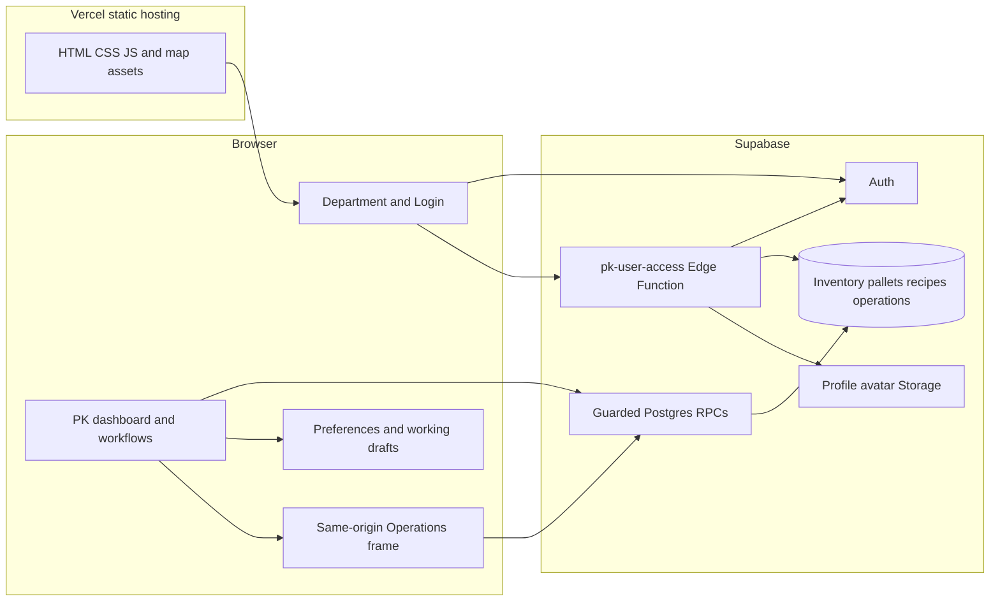
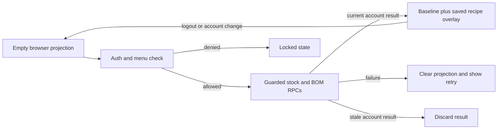

# PK WMS — architecture

Repository review: 15 October 2026 at `bf518e7`; live database evidence remains dated 9 October 2026. **Observed** means code/config/database metadata was inspected; **proposed** means not yet shipped; **unknown** means not measured. Product contract: [PRD.md](PRD.md). Visual contract: [DESIGN_SYSTEM.md](DESIGN_SYSTEM.md). Agent entry: [AGENTS.md](AGENTS.md).

## Product vision and principles

One Thai packaging warehouse UI for stock, pallet movements, recipes and work tracking. Preserve units, history and optimistic concurrency. Authentication and authorization belong on the server; browser visibility is only UX. Multi-device operational state belongs in the database. Browser preferences/drafts have distinct ownership and must not be treated as disposable stock caches.

## Architecture overview — observed

## Components and data authority

| Layer / entity | Authority and paths | Copies and limitations |
|---|---|---|
| Site shell | Root static HTML and feature JS; Vercel config | No npm build step; CSS cascade carries older overrides |
| Accounts and identity | Supabase Auth plus active `app_users`; account Edge Function | Browser session determines credentials presented; server validates actor/role |
| Stock snapshots | `stock_inventory_snapshots`, guarded stock RPCs | Dashboard aggregates derive from snapshot items; browser starts empty and loads an authorized snapshot; no embedded stock fallback |
| Pallet state / history | Server pallet/movement RPCs and expected versions | Browser edit state and map are projections, not write authority |
| Legacy BOM baseline | `pk_bom_baselines` via `get_pk_bom_baseline`; RLS, no direct API-role access | 757 raw recipes / 3,476 lines, 758 FG catalog entries; exact Operations variant preserves 756 recipes |
| Saved recipes | `pk_recipes`, `pk_recipe_lines`, `pk_recipe_versions`; Admin save RPC | 0 editable recipes at migration; saved recipes override the private baseline by FG code without overwriting source data |
| Work tracking | `warehouse_ops` private tables through `warehouse_ops_rpc` | Operations UI is a same-origin frame; its server gateway checks PK Admin |
| Avatar | Edge Function validates caller/file and writes Storage | Profile URLs may be public; they must not include credentials |
| Drafts/preferences | Browser local/session storage | Counts, BOM drafts and calendar fallback contain business work; targeted cleanup preserves them |
| Receipt plan | `pk_receipt_plan_snapshots` via guarded `get_pk_receipt_plan()` | Imported from authenticated Netlify plan table; PK polls its own database every 5 minutes. Source changes require a new authorized import. No source credentials or plan rows in static assets. |

The deployed schema and database, when inspected directly, are authoritative for API guards. Some early root SQL scripts still show superseded anon grants; do not replay a single old script in isolation and assume it matches the deployed permission model.

## Stock and BOM API contract — live verification dated 9 October 2026

Base API: `https://zgsxbuckjrplkpvtlbmn.supabase.co/rest/v1/rpc/`.

| Function | Result / parameters | Access |
|---|---|---|
| `get_latest_stock_inventory` | Latest stock JSON including snapshot save time; no arguments | authenticated plus stock/reorder/BOM/planning/reconciliation menu guard; anon EXECUTE revoked |
| `get_pk_bom_baseline` | Private legacy BOM, FG catalog, Operations variant and provenance hash; no arguments | authenticated plus BOM/planning or active Admin; anon EXECUTE revoked; direct table reads denied |
| `get_pk_recipes` | Saved recipe headers with lines; no arguments | authenticated plus BOM or planning menu; anon EXECUTE revoked |
| `get_pk_recipe_versions` | Version history; `p_fg_code` | active Admin; anon EXECUTE revoked |
| `save_pk_recipe` | Save with `p_recipe`, `p_expected_version` | active Admin; version conflict rejects stale edit |
| `get_withdrawal_stock_catalog` | Codes/names/units/freshness, not stock quantities or values | Explicit anon grant for a separate dependent app; decision required before changing its contract |

Supabase JS calls RPC with the current Auth session; raw HTTP callers need the project's browser key and the user's Bearer access token. Server service keys never belong in the browser. [Supabase RPC documentation](https://supabase.com/docs/reference/javascript/rpc).

## Transaction and failure boundaries

Observed recipe saving uses a database transaction/version check to save header, lines and history together. Pallet copying carries source/destination version information; copying to the same zone is a supported operation and must preserve source receipts. Profile administration crosses Auth, profile rows and Storage; do not describe all those calls as one atomic transaction. Test partial failures when changing them.

API failures must not be reported as successful writes. Stock and recipe loading should expose loading/error/empty/ready separately. On logout or permission changes, privileged projections must be cleared and stale async responses discarded. A fallback used for availability cannot silently override a confidentiality requirement.

## Private-data lifecycle — observed

Stock and recipes have independent loading lifecycles. A missing stock response must not be presented as confirmed zero inventory. The BOM baseline preserves raw formulas; editable recipes are a separate authority and overlay by FG code. A ready baseline is a verified import, not evidence that missing units or business formula errors have been corrected.

Browser drafts/preferences are separate from API projections. Clearing privileged loaded data does not authorize deleting planning drafts or counts. Loader behavior is covered by tests/private-data-browser.cjs.

## Security and deployment boundaries

Observed: Vercel security headers allow same-origin Operations frames and camera use. CSP still permits inline scripts for the existing HTML. All public regular/partitioned tables had RLS enabled at the audit; SECURITY DEFINER RPCs still need individual guard review. `.vercelignore` excludes SQL, docs, tests, tools, server function sources, environment files and working artifacts. The public Git repository/history is a separate publication surface; excluding files from Vercel does not make Git history private.

## Completed migration: remove current public stock/BOM fallback

Imported the complete original and Operations formula variants into a private versioned baseline on 9 October. All 104 batches matched their source JSON before the baseline was marked ready. Missing FG units and duplicate/raw lines were preserved, not guessed or merged. The public root DATA is empty and operations/pk-bom.json is removed. API failures clear privileged projections; logout discards late responses. See [migration evidence and rollback](docs/PRIVATE-DATA-MIGRATION-2026-10-09.md).

This removes fallback from the current website. Previously published Git commits, old deployments and third-party copies were not erased. The separate public withdrawal catalog remains an explicit integration decision.

## Browser-derived views and load boundaries — observed in source

- The compact department/login shell is restored. RM is proxied to a separate app; FG is an external app. Selecting a department does not unify their accounts.
- Product-history date filtering runs on already loaded pallet history. It defaults to the current Bangkok month through today, filters inclusively after calculating the full ledger, and does not rewrite source movements or stock balances. Undated rows are excluded from a dated view and disclosed in UI copy.
- Overview rotation/zoom/pan is presentation state. The cropped drawing's actual bounds constrain dragging in fullscreen; reduced views are centered when smaller than the viewport. Geometry and pallet identities are unchanged.
- The library loader caches pending loads for Excel and QR libraries. Local Motion is a runtime dependency for finite entry effects, with native animation fallback. These are different from authoring skills, which do not run in the browser.
- Calendar has a local 30-second reminder tick, not an unconditional database read every 30 seconds. Visible healthy Realtime sessions have a 15-minute refresh threshold; fallback uses 2 minutes. Change notifications debounce for 180ms; requests coalesce, hidden-page reads pause, visibility restoration forces refresh.

## Coupling and ownership assessment

**Observed:** UI geometry, inventory projections and many workflows share the root HTML and browser globals. Feature modules access this shared state; Operations has a separate frame but the same deployment and database gateway. **Inferred:** this increases change propagation and the need for focused cross-feature fixtures. It is not evidence that a framework migration is required.

**Observed:** stock snapshots, retained pallet movements and external receipt plans are separate facts with different timestamps. Their totals are not interchangeable. No universal offline authority or cross-service atomic transaction is established. **Unknown:** sustained concurrency/load capacity and Auth/profile/Storage compensation under every partial failure. This review does not exercise production writes or revalidate deployed SQL grants.

## Evidence ledger and limits

| Claim | Classification | Evidence |
|---|---|---|
| Static site with Supabase and no root build | Observed | Root HTML, feature modules, config and README |
| Guarded stock/recipe reads | Observed | Live function definitions and role EXECUTE metadata on 9 October |
| Regression 111/111 and focused Login/map/history browser checks pass on 15 October | Observed in local fixtures | [Current review](docs/SKILL-REVIEW-2026-10-15.md); live DB assertions remain historical |
| Current stock/BOM fallback removed; baseline migrated | Observed | Source diff, 104 database content checks and private API browser tests; migration report |
| Long-term uptime/load capacity, backup restore guarantees | Unknown | No sustained production load/restore drill conducted |

This document maps the current system. It does not authorize unrelated framework migrations or claim complete security certification. Source skill provenance: [docs/SKILLS.md](docs/SKILLS.md).

Pallet JSON transfers (13 October 2026): Import and Export prompt for the same PIN as Update Stock. `verify_pallet_transfer_pin` checks floorplan permission and the server-held stock PIN hash; no PIN is persisted in browser storage. Import delegates to `import_pallet_changes`, which rechecks the PIN before the existing atomic `save_pallet_changes` transaction. Export gates the normal UI download; authorized pallet data remains readable by existing permissions and this is not an additional data-read authorization boundary. Regular pallet edits retain their existing guarded RPC.

Current repository evidence: [review ledger](docs/SKILL-REVIEW-2026-10-15.md). Authoring used architecture/data-ownership analysis only; backend implementation, security certification and migrations remain separate tasks. PostgreSQL/Supabase-specific guards are not a portable storage contract; another provider would require equivalent Auth/RLS/RPC behavior and validation. Static hosting can move to another HTTPS host only with equivalent rewrites, security headers and camera permission policy.

## Performance follow-up — 15 October 2026

Root embedded JPEGs now reference separately cacheable, byte-identical assets; image geometry and private-data APIs are unchanged. BOM automatic refresh is scoped to visible BOM/planning panes. Saved recipes refresh on the existing one-minute cadence there; the baseline response is reusable only in memory for up to 15 minutes. Manual refresh bypasses cache; concurrent refresh requests coalesce. Account change and load errors invalidate the baseline cache, and existing generation checks discard stale account replies. This reduces full-baseline network calls without introducing a public or persistent fallback. It is bounded caching, not a version-only RPC contract; see [implementation/validation](docs/REPORT-IMPROVEMENTS-2026-10-15.md).

15 October 2026 ROP usage evidence: reorder-points.js still evaluates static workbook rules against the latest guarded stock snapshot. reorder-usage.js reads getStockMovement from the currently loaded SLOT_ITEMS only when a selected product is analyzed. It does not request additional database data, mutate ledgers, project the stock snapshot or persist a new ROP. refreshAfterRemoteChange refreshes visible analysis, as does the reorder panel on reopening/stock refresh. The time range is Bangkok calendar dates, default 56 inclusive days. This is recorded pallet use, not an immutable or completeness-certified transaction archive. Deleted/overwritten history and unrecorded activity cannot be reconstructed. Whole moves carry one history, split moves retain history at source; transfer rows are excluded. Lead time and safety quantity are user scenario inputs only. A future automatic reorder policy needs validated coverage, supplier lead time, safety policy and an authoritative snapshot cutoff before activation.

## 21 October 2026 — online Cycle Counts

`pk_cycle_count_state` is the shared source for frequencies, the current draft and completed count results; `pk_cycle_count_audit` records server Auth actor/version/time and counts. Both tables have RLS enabled and no browser table privileges or direct policies by design. Only `get_pk_cycle_counts` / `save_pk_cycle_counts` RPCs are granted to authenticated users; both enforce active app/menu access, writes require admin/user role. This follows the existing guarded-RPC architecture. Advisors report the expected no-policy and authenticated-definer notices for these RPC-only tables/functions; anonymous execution is revoked. Existing unrelated advisor warnings were not changed.

One shared draft is supported at a time. Saves lock the singleton and compare expected version; stale writers must reload explicitly. Completed history is append-only and cannot be deleted/edited via this API. The UI stores no new online state in localStorage; unsent changes remain in the open form, can be downloaded as JSON, and trigger a leave warning. Explicit **บันทึกแบบร่างออนไลน์** saves partial input; completing a count still does not adjust stock. A 30-second visible-pane poll and manual refresh synchronize idle devices; dirty forms are never replaced by polling. Account changes clear private state and discard late replies.

Legacy browser data is retained. **นำข้อมูลเดิมในเครื่องขึ้นออนไลน์** merges only missing schedules, deduplicates completed runs by zone/start/completion, keeps an existing online draft, and leaves the legacy key unchanged. A local draft that conflicts with an online draft remains in the legacy source. Untrusted legacy data is validated by the same server save checks. Current document size is capped at 8 MiB; before growth reaches this limit, move completed runs into paginated per-job tables instead of pruning history.
